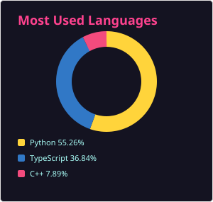

Hey, I am Sarthak.

e/acc. Into tech, science and philosophy.

Open source at [@existence-master](https://github.com/existence-master).

&emsp;

### Skills

**Languages and frameworks**

**AI / ML**

**Data and infrastructure**

**Hardware and tools**

